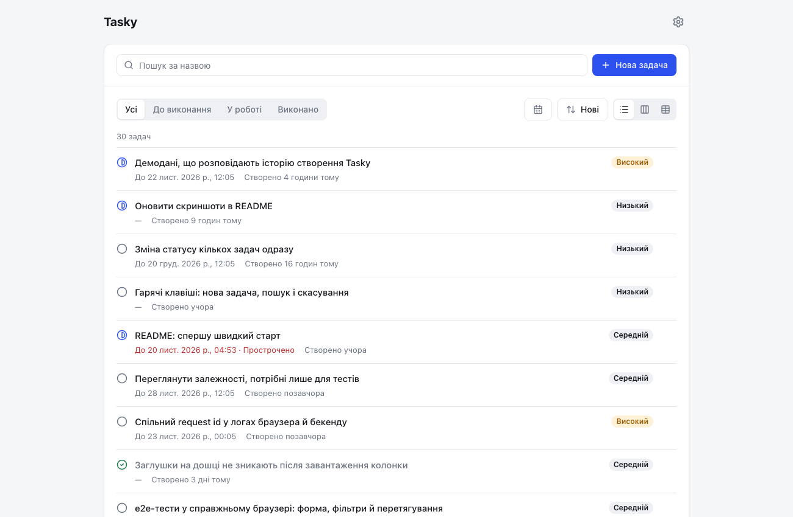
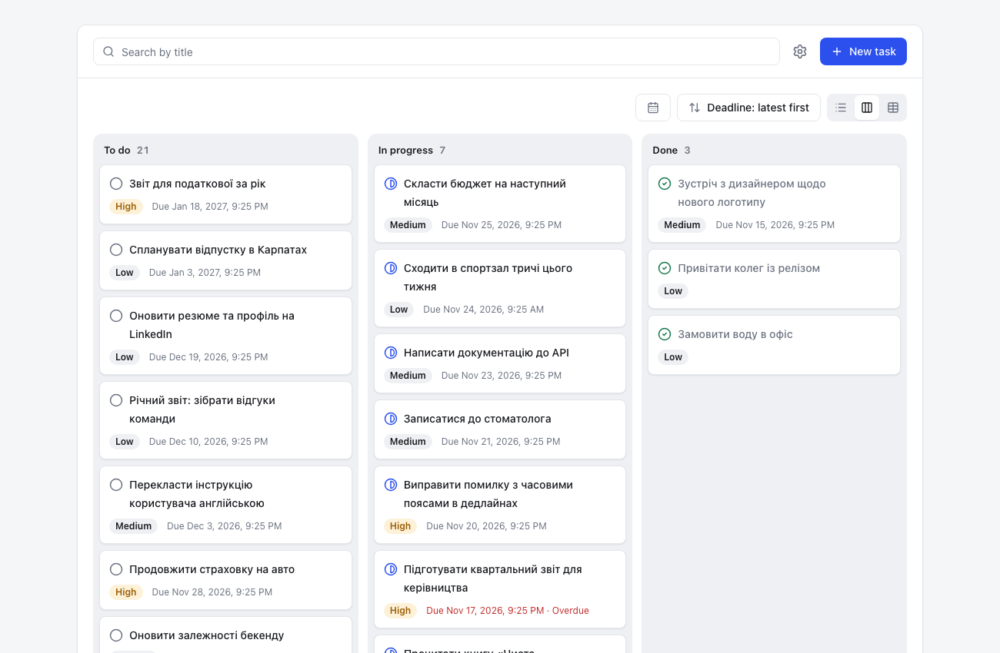
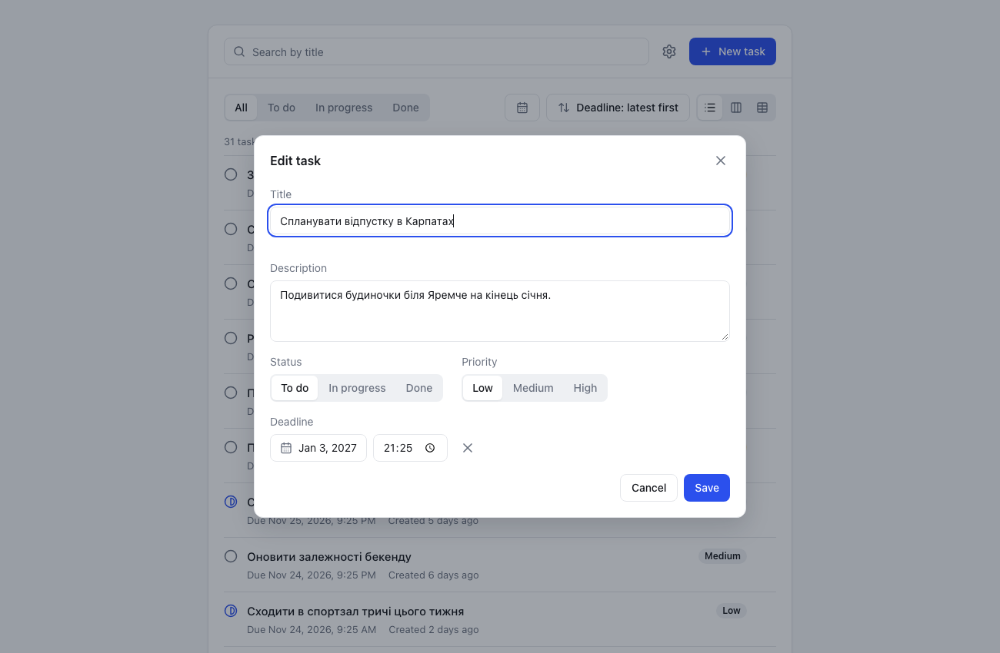
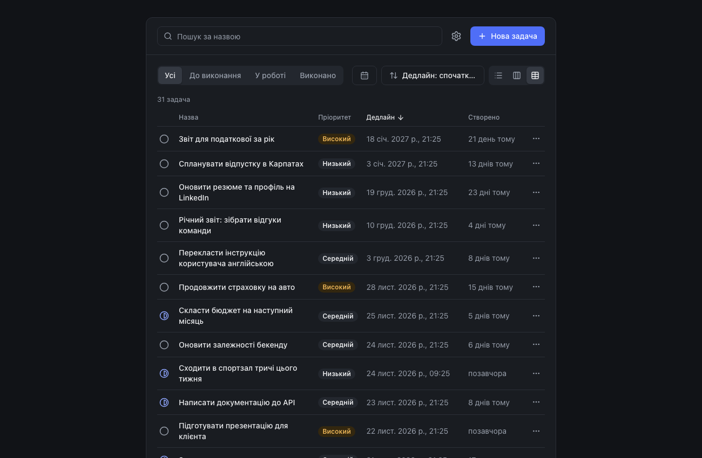

# Tasky

A task manager: a FastAPI + PostgreSQL REST API and a Vue 3 single-page app, run with Docker Compose.

## Quick start

You need Docker with the Compose plugin (`docker compose version`). Then:

```bash
git clone https://github.com/mnrlmnstr/tasky-demo.git
cd tasky-demo
docker compose up --build
```

Open http://localhost:8080. The API docs are at http://localhost:8000/docs (Swagger UI) and http://localhost:8000/redoc (ReDoc).

No `.env` file or other setup is needed. On first start the database is migrated and filled with 30 demo tasks.

Port 8080 or 8000 taken? Pick others: `FRONTEND_PORT=18080 BACKEND_PORT=18000 docker compose up --build`.

Stop with `Ctrl+C` (or `docker compose down`). Remove everything, including the database: `docker compose down -v`.



## Contents

- [Features](#features)
- [Configuration](#configuration)
- [Development](#development)
- [API](#api)
- [Project structure](#project-structure)

## Features

| Board | Edit form |
| ----- | --------- |
|  |  |



- **Views** (switch in the toolbar):
  - list: one row per task with status, title, priority, deadline and creation date, paginated;
  - board: three columns (To do, In progress, Done) with counts; drag a card to any place in any column: a line shows where it lands, and dragging switches the sorting to the custom order (from the keyboard, the card's status menu changes the column and has Move up and Move down); each column shows up to 100 tasks and says how many it leaves out;
  - table: sortable Deadline and Created headers and an actions menu on each row, paginated.
- **Finding tasks:**
  - search by title (sent after a 300 ms pause in typing);
  - status filter: All, To do, In progress, Done (the board shows every status in its columns);
  - deadline filter: one day or a range picked in a calendar, with quick picks Today, This week and Overdue; either end can stay open;
  - sorting: newest or oldest first, deadline soonest or latest first (tasks with no deadline go last), or the custom order, where new tasks start on top and list rows get a handle to drag them by (its menu has Move up and Move down);
  - "Clear filters" in the toolbar and on a filtered list that comes back empty.
- **Changing tasks:**
  - create and edit in one form: title, description, status, priority, and a deadline with a calendar and a time field; the API's validation errors show next to their fields;
  - change the status from the status menu on a row or a card, or by dragging on the board;
  - delete from a row or a card, behind a confirmation (there is no restore);
  - create, edit, status changes and moves show a toast with **Undo** for 6 seconds (the timer pauses while the toast is hovered or focused). Delete has no undo.
- **Settings** (gear button): theme (light, dark, system), tasks per page (10, 20, 50, All: every matching task on one page, without pagination), language (Українська, English; the first visit follows the browser), density (comfortable, compact), show the first line of descriptions in rows and cards.
- **States:** loading and updating indicators, an empty list, "no tasks match your filters", and error messages by kind (network, server, task not found) with a **Try again** button.
- Dates, relative times ("3 days ago") and plurals follow the chosen language; overdue deadlines are marked.

### State and persistence

| Where | Key | What |
| ----- | --- | ---- |
| URL query | `search`, `status`, `ordering`, `deadline_from`, `deadline_to`, `page`, `view` | the current view, so a link or a reload shows the same tasks; default values are left out of the address |
| local storage | `tasky:list-view` | the same filters and view (not the page), used when the address has none of them |
| local storage | `tasky:settings` | theme, page size, language, density, show descriptions |

The address wins over local storage. Invalid values in either are replaced with defaults one field at a time. Filter, sort, page and view changes add a browser history step, so Back returns to the previous view; typing in the search replaces the current step instead. If local storage is blocked, the app still works and keeps the view in the address only.

### Demo data

On first start the backend loads 30 demo tasks (titles and descriptions in Ukrainian) with mixed statuses and priorities, past, future and missing deadlines, and creation dates spread over the last 30 days. They are loaded only into a tasks table with no rows at all (soft-deleted tasks count), so restarts add nothing and your changes are kept.

- Start with an empty database: set `SEED_DEMO_DATA=false` before the first start.
- Replace all tasks with a fresh demo set at any time: `docker compose exec backend python -m app.seed --reset`.

## Configuration

Every variable is optional and has a working default in `docker-compose.yml`. Set them in the shell or copy `.env.example` to `.env` and edit the copy.

| Variable            | Default  | Description                                                         |
| ------------------- | -------- | ------------------------------------------------------------------- |
| `FRONTEND_PORT`     | `8080`   | host port of the application                                        |
| `BACKEND_PORT`      | `8000`   | host port of the API and its docs                                   |
| `POSTGRES_USER`     | `tasky`  | database user                                                       |
| `POSTGRES_PASSWORD` | `tasky`  | database password                                                   |
| `POSTGRES_DB`       | `tasky`  | database name                                                       |
| `SEED_DEMO_DATA`    | `true`   | load the demo tasks on start; `false` starts with an empty database |

`POSTGRES_USER` and `POSTGRES_PASSWORD` are inserted as they are into the backend's database URL, so they must be URL-safe: no `@`, `/` or `:` (letters, digits, `-` and `_` are fine). The credentials are applied when the database volume is first created; to change them later, reset the volume with `docker compose down -v`.

PostgreSQL is not published to the host. The frontend calls the API with relative URLs (`/api/v1/...`) and the Vite dev server forwards every `/api` request to `API_PROXY_TARGET` (default `http://backend:8000`, see `frontend/vite.config.ts`), so the browser only talks to the frontend's origin: no CORS setup and no API address baked into the build.

## Development

| Layer    | Stack                                                                         |
| -------- | ----------------------------------------------------------------------------- |
| Backend  | Python 3.13, FastAPI, SQLAlchemy 2 (async), Alembic, Pydantic, uv             |
| Database | PostgreSQL 17                                                                 |
| Frontend | Vue 3, Vite, TypeScript, Pinia, vue-i18n, Tailwind CSS 4, Reka UI, Orval, npm |
| Tests    | pytest, pytest-cov, httpx, Vitest, Vue Test Utils, happy-dom                  |

### Watch mode

```bash
docker compose up --build --watch
```

Backend code and tests are synced into the container and the server reloads; changes to migrations restart the backend (which applies them); changes to dependencies rebuild the image. The frontend works the same way with Vite's hot reload.

To run the frontend dev server on the host instead, against a backend published on port 8000 (it listens on http://localhost:5173):

```bash
cd frontend && npm ci
API_PROXY_TARGET=http://localhost:8000 npx vite
```

### Tests, lint and type checks

With the stack running:

```bash
docker compose exec backend pytest                      # tests with coverage
docker compose exec backend ruff check .                # lint
docker compose exec backend ruff format --check .       # formatting
docker compose exec frontend npm run check              # typecheck, lint, tests with coverage
```

- Backend: the suite runs against a real PostgreSQL test database (`<POSTGRES_DB>_test` in the same `db` container, created on first run); each test is isolated by a rolled-back transaction. Every run fails if coverage of `app/` lines and branches drops below 100%. For a subset, turn coverage off: `docker compose exec backend pytest tests/integration/test_tasks_list.py --no-cov`.
- Frontend (also from `frontend/` on the host after `npm ci`): `npm run check` runs `npm run typecheck` (vue-tsc), `npm run lint` (ESLint; `npm run lint:fix` applies fixes) and `npm run test:coverage` (Vitest, 100% threshold) in that order, stopping at the first failure; `npm test` runs the tests alone. Tests sit next to the code (`*.test.ts`); app-level tests run `App.vue` against an in-memory fake of the API (`src/test/`). Coverage counts `src/**/*.{ts,vue}` except the generated client. ESLint runs the recommended rules of `eslint-plugin-vue` and the type-aware recommended rules of `typescript-eslint`; there is no formatter, so the layout-only rules are off.
- End to end (needs `curl` on the host): `scripts/smoke.sh` builds and starts the stack under its own Compose project, checks the page, the API through the frontend proxy, Swagger UI and the database, then removes everything it started. It needs free ports: `FRONTEND_PORT=18080 BACKEND_PORT=18000 scripts/smoke.sh` if 8080 or 8000 is taken.

### Migrations

The backend runs `alembic upgrade head` on every start, so there is nothing to apply by hand. To add a migration, change the models in `backend/app/models/`, then generate it in the running container and copy it back to the host:

```bash
docker compose exec backend alembic revision --autogenerate --rev-id 0004 -m "describe the change"
docker compose cp backend:/app/alembic/versions/0004_describe_the_change.py backend/alembic/versions/
```

Review the file, then `docker compose restart backend` to apply it. `docker compose exec backend alembic check` reports whether the models and the migrations agree.

### API client

`frontend/src/api/generated/client.ts` is generated by [Orval](https://orval.dev) from the backend's OpenAPI spec and wraps `fetch` with `src/api/http.ts`, which throws typed errors. Regenerate it after any route or schema change (on the host; needs `uv sync` in `backend/` and `npm ci` in `frontend/`):

```bash
cd backend && .venv/bin/python -m scripts.export_openapi   # writes frontend/openapi.json
cd ../frontend && npm run api:generate                     # rewrites frontend/src/api/generated
```

Both outputs are committed; `frontend/src/api/generated` is never edited by hand, and nothing checks that it matches the API.

## API

Base path: `/api/v1` (the base path itself answers 404). Full schemas and examples: [Swagger UI](http://localhost:8000/docs) or [ReDoc](http://localhost:8000/redoc).

| Method   | Path          | Description                          | Success |
| -------- | ------------- | ------------------------------------ | ------- |
| `GET`    | `/health`     | liveness and database check          | `200`   |
| `GET`    | `/tasks`      | list tasks (see query parameters)    | `200`   |
| `POST`   | `/tasks`      | create a task                        | `201`   |
| `GET`    | `/tasks/{id}` | get one task                         | `200`   |
| `PATCH`  | `/tasks/{id}` | partially update a task              | `200`   |
| `DELETE` | `/tasks/{id}` | delete a task (soft delete)          | `204`   |

A task:

| Field         | Type                              | Notes                                   |
| ------------- | --------------------------------- | --------------------------------------- |
| `id`          | UUID (v4)                         | set by the server                       |
| `title`       | string, 1–200 characters          | required; surrounding spaces are trimmed |
| `description` | string or `null`                  | optional                                |
| `status`      | `todo` \| `in_progress` \| `done` | default `todo`                          |
| `priority`    | `low` \| `medium` \| `high`       | default `medium`                        |
| `deadline`    | datetime with a time zone, or `null` | optional; returned in UTC            |
| `position`    | number                            | place in the custom order, lower first; new tasks go on top; `PATCH` takes any finite number |
| `created_at`  | datetime (UTC)                    | set by the server                       |
| `updated_at`  | datetime (UTC)                    | set by the server on every update       |

`PATCH` changes only the fields it is sent; `null` clears `description` or `deadline`. Unknown and read-only fields are rejected.

Query parameters for `GET /tasks`:

| Param       | Example       | Description                                                                                        |
| ----------- | ------------- | -------------------------------------------------------------------------------------------------- |
| `status`    | `in_progress` | filter by status                                                                                   |
| `search`    | `звіт`        | case-insensitive substring of the title; `%` and `_` match literally                               |
| `ordering`  | `-created_at` | `created_at` or `deadline`, prefix `-` for descending; default `-created_at`; no deadline sorts last; `position` is the custom order (ascending, ties newest first) |
| `page`      | `1`           | page number, starting at 1 (default 1)                                                             |
| `page_size` | `20`          | items per page, 1–100 (default 20)                                                                 |

List response:

```json
{
  "items": [],
  "total": 0,
  "page": 1,
  "page_size": 20,
  "pages": 0
}
```

`DELETE` is a soft delete: the task stays in the database but disappears from the API (getting, updating or deleting it again answers 404, and lists leave it out). There is no restore.

Errors:

| Status | When                                            | Body                                                        |
| ------ | ----------------------------------------------- | ----------------------------------------------------------- |
| `404`  | no task with that id, or it was deleted         | `{"detail": "Task not found"}`                               |
| `422`  | invalid body, query parameter or id             | `{"detail": [{"loc": [...], "msg": "...", "type": "..."}]}` |
| `500`  | unexpected server error (details go to the log) | `{"detail": "Internal server error"}`                        |

## Project structure

```
tasky-demo/
├── backend/
│   ├── app/
│   │   ├── api/          # FastAPI routers, error handlers, OpenAPI setup
│   │   ├── services/     # business logic and queries (tasks, health, demo seed)
│   │   ├── models/       # SQLAlchemy models and enums
│   │   ├── schemas/      # Pydantic request and response schemas
│   │   ├── core/         # settings, database engine and sessions, logging
│   │   ├── seed.py       # `python -m app.seed [--reset]`
│   │   └── main.py       # app factory
│   ├── alembic/          # migrations
│   ├── tests/            # pytest suite (integration tests on PostgreSQL)
│   ├── Dockerfile
│   ├── entrypoint.sh     # migrations, demo data, then the server
│   └── pyproject.toml
├── frontend/
│   ├── src/
│   │   ├── api/          # generated Orval client, fetch wrapper and errors, query string, latest-request guard
│   │   ├── components/   # ui/ primitives (on Reka UI), tasks/ (toolbar, list, board/, table/, form), settings/, undo/
│   │   ├── stores/       # Pinia: tasks, board, list view (URL + storage), settings, form, undo
│   │   ├── i18n/         # uk and en messages, date, number and error formatting
│   │   ├── styles/       # Tailwind entry and theme tokens (light and dark)
│   │   ├── test/         # shared test helpers and the fake API
│   │   ├── App.vue
│   │   └── main.ts
│   ├── openapi.json      # API spec exported from the backend, input of the client generator
│   ├── orval.config.ts
│   ├── vite.config.ts    # dev server, `/api` proxy, Vitest
│   └── Dockerfile
├── docs/screenshots/     # images used in this README
├── scripts/smoke.sh      # end-to-end check of the Compose setup
├── docker-compose.yml
├── .env.example
└── README.md
```

Backend requests flow `api → services → models`: routers validate input with the schemas and call plain service functions, which work on the SQLAlchemy models through an async session.
